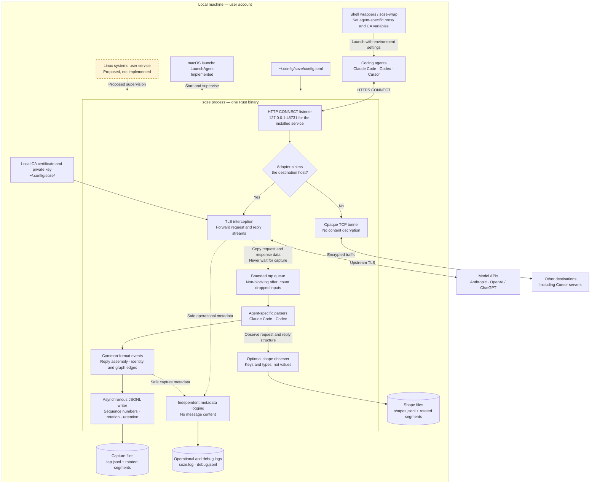

# System architecture overview

Soze is a local, per-user HTTPS proxy with a non-blocking capture pipeline. Coding agents
communicate with their providers through it; a separate tap converts copied traffic into the
[common event format](../common-format.md).

This document describes the current implementation. The Linux service supervisor in the
diagram is a proposal, not an implemented service backend. See [service lifecycle and
storage](service-lifecycle.md) for platform behavior, commands and retention.

## Architecture diagram

Dashed data-path arrows show copied traffic, observations or metadata, not forwarding
dependencies. The separately styled Linux supervisor is the only proposed component.
The diagram groups related responsibilities; it is not a task-by-task execution graph.

## Agent integration

The shell wrappers configure individual processes rather than changing system proxy settings:

| Agent | Process environment | Capture support |
| --- | --- | --- |
| Claude Code | `HTTPS_PROXY`, `NODE_EXTRA_CA_CERTS` | Anthropic Messages requests and streamed replies |
| Codex | `HTTPS_PROXY`, `CODEX_CA_CERTIFICATE` | OpenAI Responses requests and streamed replies |
| Cursor (`agent`) | `HTTPS_PROXY` | Opaque tunnelling only; no model-content parsing |

The wrappers add these settings only when the proxy port is listening, the CA certificate is
readable and neither `HTTPS_PROXY` nor `https_proxy` is already set. Otherwise, they launch the
real command without adding Soze settings. A listening-port check does not establish that the
process on that port is a healthy Soze instance.

This decision happens when the agent starts. It is not mid-session failover: an agent already
using the proxy loses its connection if Soze stops. `SOZE_OFF=1` bypasses the wrappers for one
command; `command claude` and `command codex` bypass the corresponding shell functions.

## Forwarding and TLS

The binary listens on IPv4 loopback and accepts HTTP `CONNECT` requests. The installed service
uses port 48731; `task dev` uses 48732, and the binary can use another configured port.

An adapter names the hosts Soze may decrypt. Claude Code claims `api.anthropic.com`; Codex
claims `chatgpt.com` and `api.openai.com`. Host matching includes subdomains of those names.

- **Claimed host:** Soze terminates agent-side TLS using its local CA and establishes upstream
  TLS to the provider. Request and response data are forwarded without waiting for capture.
- **Unclaimed host:** Soze tunnels encrypted bytes without decrypting the content.
- **Claimed host, unsupported endpoint:** Forwarding continues, with an `unsupported` capture
  note rather than a parsed model exchange.

The CA is created on first run, constrained to adapter hosts and never installed into a system
trust store. Only explicitly configured agents trust it. Credential headers are redacted before
capture output is written.

## Capture pipeline

The forwarding path offers copies of request and response data to a bounded queue without
waiting for a parser or disk. Slow or failed capture must not delay forwarding.

Adapters interpret each agent's wire format, including SSE and WebSocket traffic. They emit
common-format conversation, block, usage and reply-completion events. The assembler builds a
whole conversation/reply record, and identity tracking adds project, session, thread, exchange,
step, turn and tool-call relationships where the traffic supplies them.

These graph edges are records in the JSONL capture output, not a separate graph database.
Optional shape output records keys and types without values. Operational and debug logging
use independent bounded transports and exclude message content.

The tap writer assigns emitted lines a `run_id` and monotonically increasing `sequence`.
Every proxy instance has a fresh `run_id`; restarting Soze starts a new capture run, not
necessarily a new agent session. See the [capture identity and delivery-order
contract](../common-format.md#capture-identity-and-delivery-order).

If capture falls behind, inputs can be dropped and counted. Records report incomplete capture
where detected. Contiguous output sequences do not prove complete capture, because refused
inputs never receive sequence numbers. This is best-effort observation, not an exactly-once
or durable audit system. Invalid configuration or initialization failures can still prevent
the proxy from starting.

## Scope and management boundaries

Soze is one Rust crate and one binary. It does not own the agent's tool-execution loop or run
the model. The intended service deployment is one proxy per user, without root privileges;
the current installer implements that on macOS only.

The CLI starts the proxy and accepts configuration flags, but has no status, storage-usage or
session-listing subcommands. The macOS task commands query the supervisor separately; see
[management and visibility](service-lifecycle.md#management-and-visibility).

How other applications receive the common format remains undecided. This architecture assumes
no message bus, database, replay service or live-consumer transport. The [project
objective](../objective.md) defines that boundary.

## Implementation map

| Responsibility | Entry point |
| --- | --- |
| Startup, configuration and reload | [`src/main.rs`](../../src/main.rs), [`src/cli.rs`](../../src/cli.rs), [`src/config.rs`](../../src/config.rs), [`src/reload.rs`](../../src/reload.rs) |
| CONNECT routing, TLS, HTTP and WebSocket forwarding | [`src/proxy.rs`](../../src/proxy.rs), [`src/proxy/`](../../src/proxy/) |
| Adapter interface and agent parsers | [`src/adapter/`](../../src/adapter/) |
| Exchange lifecycle and non-blocking tap | [`src/exchange/`](../../src/exchange/) |
| Reply assembly and graph relationships | [`src/assembler/`](../../src/assembler/), [`src/graph/`](../../src/graph/) |
| JSONL writing, rotation and retention | [`src/sink.rs`](../../src/sink.rs) |
| Metadata-only logging | [`src/logging/`](../../src/logging/) |
| Service installation and shell integration | [`scripts/service.sh`](../../scripts/service.sh), [`scripts/soze-wrappers.sh`](../../scripts/soze-wrappers.sh) |

For a source-level view of the forwarding and capture seams, see the
[detailed Mermaid diagram](2026-11-06_current-architecture.mmd).
